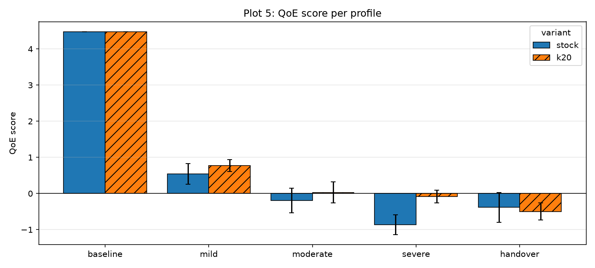
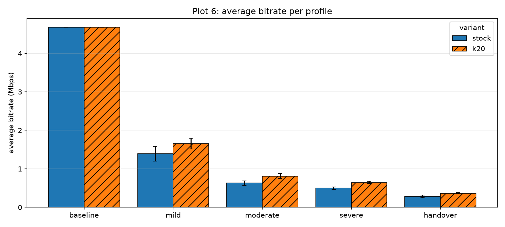
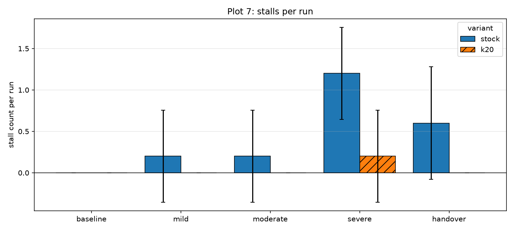
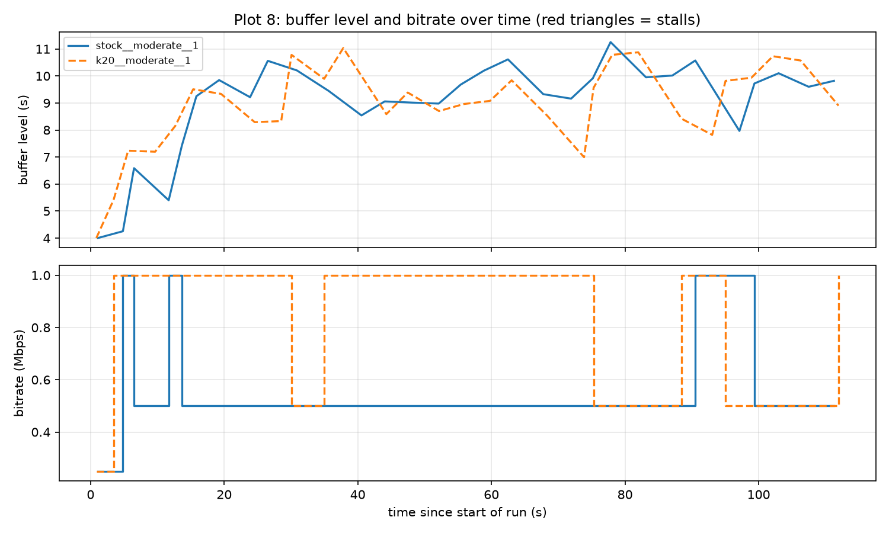

# **Reordering-Resilient QUIC for HTTP/3 Video Streaming on Mobile Paths**

## Introduction

QUIC is a transport protocol used by HTTP/3 to transfer data between a client and a server. It is designed to provide reliable and secure communication. However, when the network connection changes or packets arrive out of order, QUIC may face performance issues.

These situations are common in mobile networks, where the connection quality can change frequently. When a packet does not arrive within the expected time, the sender may consider it lost and retransmit the data. Sometimes, the packet is not actually lost but is only delayed. This can lead to unnecessary retransmissions and changes in the congestion window, which may affect the overall transfer speed.

In this project, we study how packet reordering and changing network conditions affect QUIC performance. We compare the default QUIC configuration with a modified configuration that uses a larger threshold for loss detection. We also compare the results with TCP under different network conditions.

The main aim is to understand whether changing the loss-detection threshold can improve QUIC performance when the network experiences delay, packet reordering, and handover-like conditions.

## Problem Statement

In mobile networks, packets may arrive later than expected or in a different order because of changing network paths and network conditions. QUIC may interpret some delayed packets as lost, even when they eventually arrive. These spurious loss declarations can affect congestion control and reduce transfer performance.

The problem addressed in this project is to understand how QUIC behaves under different levels of network impairment and whether increasing the loss-detection threshold can reduce the impact of packet reordering and improve data transfer performance.

## Objectives

The main objectives of this project are:

1. To study the performance of QUIC under different network conditions.

2. To compare the default QUIC configuration with a modified configuration using a larger loss-detection threshold.

3. To measure metrics such as goodput, completion time, declared packet loss, spurious loss, and congestion-window behavior.

4. To compare QUIC performance with TCP under the tested network profiles.

5. To generate plots and analyze the results to understand the effect of the threshold modification.

## Experimental Setup

The experiments were conducted using the aioquic implementation. A 10 MB file transfer was used to evaluate the performance of the different configurations.

Two QUIC configurations were tested:

* Stock QUIC: The default QUIC configuration.

* Huge-threshold QUIC: A modified configuration using a larger loss-detection threshold, set to 20 for these experiments.

TCP results were also collected to provide a comparison with the QUIC configurations.

The experiments used five network profiles:

* Baseline: Represents the normal network condition used as the reference.

* Mild: Represents a mildly impaired network.

* Moderate: Represents a moderately impaired network.

* Severe: Represents a heavily impaired network.

* Handover: Represents a network condition intended to model changes in the connection or network path.

For each QUIC configuration, five runs were performed for each of the five profiles. This resulted in 50 planned QUIC runs: 25 for stock QUIC and 25 for huge-threshold QUIC. The TCP results were collected separately.

The experiment results were stored in CSV files, and the QUIC logs were analyzed to calculate the performance metrics. Plots were then generated to compare the configurations across the different profiles.

## Performance Metrics

The following metrics were used to analyze the experiment results.

* Goodput: Goodput measures the rate at which useful application data is transferred successfully. It is measured in Mbps. Higher goodput indicates that the file is being transferred more quickly.

* Completion Time : Completion time is the time required to complete the file transfer. A lower completion time indicates better transfer performance.

* Declared Packet Loss : This metric represents the number of packets that the QUIC implementation declared lost during a transfer. A high value does not necessarily mean that all those packets were permanently lost.

* Spurious Loss : Spurious loss occurs when a packet is declared lost but is subsequently received. This metric helps us understand how delayed or reordered packets may affect QUIC's loss detection.

* Congestion-Window Behavior: The congestion window controls how much data can be in flight before acknowledgements are received. Studying congestion-window changes helps us understand how loss detection and congestion control may affect transfer performance.

## Results and Discussion

The results were calculated from the 50 QUIC runs, with five repetitions for each configuration and network profile. The following table shows the average goodput obtained for each configuration.

| Network profile | Stock QUIC(Mbps) | Huge-threshold QUIC(Mbps) | TCP(Mbps) |
| --- | --- | --- | --- |
| Baseline | 14.35 | 14.43 | 13.86 |
| Mild | 2.30 | 3.16 | 10.95 |
| Moderate | 1.03 | 1.49 | 5.27 |
| Severe | 0.84 | 1.07 | 2.66 |
| Handover | 0.50 | 0.59 | 1.43 |

### Comparison Between Stock and Huge-Threshold QUIC

Under baseline conditions, both QUIC configurations achieved similar goodput. Stock QUIC achieved an average of 14.35 Mbps, while huge-threshold QUIC achieved 14.43 Mbps. This indicates that the threshold modification had very little effect under the baseline condition.

Under mild network conditions, stock QUIC achieved 2.30 Mbps, while huge-threshold QUIC achieved 3.16 Mbps. This is an improvement of approximately 37.5%.

Under moderate conditions, the average goodput increased from 1.03 Mbps for stock QUIC to 1.49 Mbps for huge-threshold QUIC, an improvement of approximately 44.1%.

Under severe conditions, huge-threshold QUIC achieved 1.07 Mbps compared with 0.84 Mbps for stock QUIC. During handover, the average goodput increased from 0.50 Mbps to 0.59 Mbps.

Overall, huge-threshold QUIC achieved higher mean goodput than stock QUIC in all five tested profiles. The largest relative improvements were observed under mild and moderate network conditions.

### Comparison with TCP

TCP achieved higher average goodput than both QUIC configurations in all four impaired network profiles. For example, under mild conditions, TCP achieved 10.95 Mbps, compared with 3.16 Mbps for huge-threshold QUIC. Under moderate conditions, TCP achieved 5.27 Mbps, compared with 1.49 Mbps for huge-threshold QUIC.

Under severe and handover conditions, the goodput of all configurations decreased. However, TCP maintained a higher average goodput than either QUIC configuration in these tests.

These results show that the threshold modification improved QUIC's performance relative to stock QUIC, but it did not make QUIC outperform TCP under the tested impaired network conditions.

### Completion Time

The average completion time also improved with the huge-threshold configuration across all five network profiles.

For example, under handover conditions, stock QUIC required an average of 167.71 seconds to complete a transfer, while huge-threshold QUIC required 142.54 seconds. This represents a reduction of approximately 15.0% in average completion time.

Under baseline conditions, the completion times were almost identical: 5.95 seconds for stock QUIC and 5.94 seconds for huge-threshold QUIC.

This follows the same general pattern as the goodput results, where the modified configuration showed more noticeable improvements under impaired network conditions.

### Packet Loss and Spurious Loss

The packet-loss analysis showed that stock QUIC and huge-threshold QUIC behaved differently in terms of declared losses and spurious losses.

Under impaired network conditions, both configurations showed high spurious-loss rates. For example, the average spurious-loss rate under mild conditions was 95.87% for stock QUIC and 90.81% for huge-threshold QUIC. Under moderate conditions, the corresponding values were 93.28% and 91.67%.

During handover, the rates were similar for both configurations, at approximately 83%.

These results suggest that many packets declared lost during impaired network conditions were subsequently received. However, the results alone do not establish why this occurred or whether the threshold modification was the only factor responsible for the observed differences.

Further analysis of the packet logs and congestion-window behavior is needed to understand the relationship between packet reordering, loss detection, and transfer performance.

### Loss Rule Attribution

The historical attribution analysis processed 100 server-side qlogs containing 53,855 loss events. These qlogs did not contain the required attribution metadata (`rule`, `by_packet`, and `by_time`), resulting in 0% attribution coverage.

To address this limitation, we conducted a new instrumented experiment matrix containing 50 runs across stock and K20 variants and all five network profiles. The analysis processed 50 server-side qlogs and identified 26,786 application-level loss events. All these events contained usable attribution metadata, giving 100% attribution coverage.

The new results show differences in the distribution of packet-based, time-based, combined, and PTO-based loss attribution between stock and K20. The detailed methodology, historical results, and new instrumented results are presented in [Loss Rule Attribution Analysis](section_attribution.md).

### New Instrumented Experiment: Goodput and Statistical Analysis

A separate performance analysis was conducted using the new instrumented experiment matrix described in the loss rule attribution section. This dataset contains five runs for each variant-profile combination, comparing stock QUIC with K20.

The table reports the mean goodput, the difference between K20 and stock, and the results of Welch's t-test.

| Profile | Stock (Mbps) | K20 (Mbps) | Difference (Mbps) | Improvement | 95% CI for difference (Mbps) | Holm-adjusted p-value |
|---|---:|---:|---:|---:|---:|---:|
| Baseline | 13.381 | 13.334 | -0.047 | -0.35% | [-0.112, 0.017] | 0.1127 |
| Mild | 2.447 | 2.915 | 0.468 | 19.14% | [0.008, 0.929] | 0.0947 |
| Moderate | 0.983 | 1.305 | 0.322 | 32.75% | [0.218, 0.426] | 0.0010 |
| Severe | 0.788 | 1.038 | 0.250 | 31.70% | [0.222, 0.278] | 1.61e-7 |
| Handover | 0.472 | 0.600 | 0.128 | 27.23% | [0.099, 0.158] | 0.0002 |

Welch's two-sample t-test was used to compare the mean goodput of stock and K20 for each network profile. Holm correction was applied to account for the five statistical comparisons. Statistical significance was assessed at the 0.05 level.

The results indicate that K20 achieved higher mean goodput under mild, moderate, severe, and handover conditions. The largest relative improvements were observed under moderate and severe conditions.

After Holm correction, the differences were statistically significant under moderate, severe, and handover conditions. The mild-profile improvement was not statistically significant after correction, and there was no statistically significant difference under baseline conditions.

The confidence intervals shown are the individual, unadjusted 95% Welch confidence intervals. The statistical tests are based on five repetitions per configuration and should therefore be interpreted as preliminary evidence.

These results belong to the new instrumented experiment matrix and are reported separately from the earlier performance results. TCP was not included in this new matrix, so this analysis does not provide a new TCP comparison.

## Offline Threshold Analysis and Dynamic Recovery

### Offline Packet-Gap and Spurious-Loss Analysis

Historical server-side qlogs from the `threshold_20` and `huge_threshold_100` datasets were analysed to examine packet reordering and spurious-loss indicators.

The analysis covered 13,228 declared packet-loss events. Of these, 12,204 were identified as spurious-loss indicators based on subsequent acknowledgements, giving an aggregate indicator rate of approximately 92.26%.

The analysis also examined the packet-number gap between a packet declared lost and the largest acknowledged packet at the time of the loss declaration. The observed gaps varied across network profiles and datasets. One negative-gap observation was retained in the validated dataset: `threshold_20`, severe profile, run 5, packet number 7. The available qlog information was insufficient to establish its exact cause.

### Packet-Threshold Trade-off

An offline analysis evaluated candidate packet thresholds K = 3, 5, 10, 20, 50 and 100 by replaying the observed acknowledgement timelines.

The results showed a trade-off. Larger thresholds reduced the number of spurious-loss indicators for which the candidate packet threshold would have been crossed before the observed late acknowledgement. However, they also increased the delay before packet-threshold detection for packets without an observed late acknowledgement. These packets are treated as a proxy for genuine losses, not as confirmed genuine losses.

For example, the pooled median positive crossing delays at K=20 were approximately 99 ms under moderate conditions and 130 ms under severe conditions. At K=50, these increased to approximately 307 ms and 396 ms, respectively.

K=20 was identified as a useful candidate for further evaluation, while K=50 and K=100 represented more aggressive threshold settings. These are offline counterfactual estimates and do not simulate the complete QUIC recovery process, including retransmissions, congestion control and changes to subsequent ACK timelines.

### Dynamic Recovery Experiments

Three dynamic recovery experiments were conducted using a 10 MB file under the moderate network profile. All three transfers completed successfully and passed SHA-256 checksum validation.

| Run | Download time (s) | Goodput (Mbps) | Adaptation events |
|---|---:|---:|---:|
| 1 | 88.17 | 0.951 | 461 |
| 2 | 81.71 | 1.027 | 458 |
| 3 | 82.95 | 1.011 | 490 |

The average goodput was approximately 0.996 Mbps, and the average completion time was approximately 84.28 seconds.

Across the three server-side qlogs, 1,409 `recovery:k_adapted` events were recorded. These include calls where the adaptive threshold remained unchanged and should not be interpreted as actual threshold increases. The observed actual increases were 65, 59 and 64 in runs 1, 2 and 3, respectively.

The available qlogs did not record every internal threshold-decay operation. Therefore, the complete adaptive threshold timeline could not be reconstructed.

### Performance Comparison of Static and Dynamic Configurations

The following comparison uses separate 10 MB transfer datasets under the moderate network profile.

| Configuration | Runs | Mean goodput (Mbps) | Sample SD (Mbps) | Mean completion time (s) |
|---|---:|---:|---:|---:|
| Stock, K20 dataset | 5 | 0.9924 | 0.0650 | 84.81 |
| K=20 | 5 | 1.2802 | 0.0727 | 65.70 |
| Stock, K100 dataset | 5 | 0.9784 | 0.0405 | 85.86 |
| K=100 | 5 | 1.3634 | 0.1666 | 62.25 |
| Dynamic | 3 | 0.9963 | 0.0401 | 84.28 |

All reported transfers passed SHA-256 validation.

K=100 achieved the highest mean goodput among these configurations, followed by K=20. However, K=100 also showed greater run-to-run variability. The dynamic configuration achieved mean goodput close to the two stock baselines in this three-run experiment.

These results are descriptive comparisons rather than a fully controlled statistical comparison because the configurations belong to separate experiment datasets and have different run counts.

Figure: `../analysis/final_goodput_comparison.png`

### Congestion-Window Analysis

Congestion-window behaviour during the dynamic experiments was examined using server-side `recovery:metrics_updated` qlog events.

| Metric | Run 1 | Run 2 | Run 3 |
|---|---:|---:|---:|
| CWND samples | 18,920 | 18,591 | 19,098 |
| Initial CWND (bytes) | 12,000 | 12,000 | 12,000 |
| Minimum CWND (bytes) | 2,400 | 2,400 | 2,400 |
| Maximum CWND (bytes) | 71,532 | 37,704 | 57,724 |
| Final CWND (bytes) | 15,140 | 23,047 | 19,948 |
| Observed decrease samples | 262 | 260 | 178 |

The congestion window varied considerably across the three runs. The decrease counts represent sample-to-sample decreases and do not necessarily correspond to distinct congestion events. The available measurements do not establish a causal relationship between adaptive threshold changes and congestion-window reductions.

Figures:
- `../analysis/dynamic_cwnd_over_time.png`
- `../analysis/dynamic_cwnd_summary.csv`

## Video Streaming Workload Evaluation

### Motivation and Methodology

Bulk-transfer goodput does not fully describe the quality experienced by a video-streaming user. A video player buffers content ahead of playback and adapts its bitrate according to observed throughput. Network impairment can therefore affect startup delay, playback stalls, delivered bitrate and quality changes.

To study these effects, we evaluated a DASH playback simulator over the same namespace topology, server, 15 Mbit link and five netem profiles used in the bulk-transfer experiments.

The workload used a two-minute test video with five nominal renditions (0.25, 0.5, 1, 2.5 and 5 Mbps), four-second segments and a common manifest with keyframe-aligned representations. The client used one persistent HTTP/3 connection with Cubic and sequential segment requests. Its bitrate adaptation rule used the harmonic mean of the last three segment download throughputs multiplied by 0.8. The first segment was requested at the lowest quality, and the playback buffer was capped at 12 seconds.

Playback was simulated in real time; decoding was not performed and audio was ignored. Startup delay was measured from before the QUIC handshake until one segment was buffered. A stall began when the playback buffer reached zero before the video finished and ended when another segment was buffered.

The measured metrics were startup delay, stall count, total stall time, average delivered bitrate and number of quality switches. We also calculated a QoE score:

\[
\mathrm{QoE} =
\mathrm{avg\_bitrate}_{Mbps}
- 0.3(\mathrm{stalls})
- 0.05(\mathrm{stall\_seconds})
- 0.1(\mathrm{quality\_switches})
\]

The weights are implemented in `video_core.py` as `QOE_STALL_COUNT = 0.3`, `QOE_STALL_SECONDS = 0.05` and `QOE_SWITCH = 0.1`. They are fixed modelling choices; a sensitivity analysis over alternative weights has not been performed.

The available video results contain three variants: stock, K20 and dynamic. Each variant was tested under five profiles with five repetitions per profile, giving 75 runs in total.

**Run provenance.** The 50 stock/K20 runs report commit `337f6f560f41e58029dd9209a28c70e5fc788571` and a dirty working tree. This commit is an ancestor of the frozen Phase 1 implementation commit `a8d846cd48deeda588146bee145d4da74fadfa46`; the source/test diff between these commits was checked and no differences were found. The 25 dynamic runs report commit `82766da6815bdfd8e6c4f1bc6f7ce539e1399f9a` and a clean working tree; this commit is a descendant of the frozen Phase 1 commit. The 75 runs are therefore reported with their respective provenance rather than being described as having been executed from one identical commit.

### Video Results

The following table reports means across five runs for each profile and variant. Values are rounded to three decimal places.

| Profile | Variant | Startup (s) | Stalls / run | Stall time (s) | Avg bitrate (Mbps) | Switches | QoE |
|---|---|---:|---:|---:|---:|---:|---:|
| Baseline | Stock | 0.604 | 0.000 | 0.000 | 4.675 | 2.0 | 4.475 |
| Baseline | K20 | 0.554 | 0.000 | 0.000 | 4.675 | 2.0 | 4.475 |
| Baseline | Dynamic | 0.565 | 0.000 | 0.000 | 4.675 | 2.0 | 4.475 |
| Mild | Stock | 0.654 | 0.200 | 0.234 | 1.392 | 7.8 | 0.540 |
| Mild | K20 | 0.664 | 0.000 | 0.000 | 1.655 | 8.8 | 0.775 |
| Mild | Dynamic | 0.762 | 0.600 | 0.932 | 1.468 | 8.4 | 0.402 |
| Moderate | Stock | 1.157 | 0.200 | 0.077 | 0.632 | 7.6 | -0.192 |
| Moderate | K20 | 1.062 | 0.000 | 0.000 | 0.808 | 7.8 | 0.028 |
| Moderate | Dynamic | 1.230 | 0.200 | 0.018 | 0.688 | 7.0 | -0.073 |
| Severe | Stock | 1.520 | 1.200 | 2.020 | 0.498 | 9.0 | -0.863 |
| Severe | K20 | 1.015 | 0.200 | 0.130 | 0.645 | 6.6 | -0.081 |
| Severe | Dynamic | 1.259 | 0.600 | 1.439 | 0.563 | 7.6 | -0.449 |
| Handover | Stock | 2.077 | 0.600 | 0.962 | 0.282 | 4.4 | -0.386 |
| Handover | K20 | 1.767 | 0.000 | 0.000 | 0.363 | 8.6 | -0.497 |
| Handover | Dynamic | 1.939 | 1.200 | 2.558 | 0.310 | 6.2 | -0.798 |

### Video Figures

Figures 5–8 use the provisional 50-run stock/K20 video subset, with five repetitions per profile and variant. These results are preliminary and do not include the dynamic or dynamic_undo variants. The corresponding plot data and alt-text files are available alongside the figures.

**Figure 5 — QoE by profile and variant.** Bars compare mean QoE for stock and K20; error bars show 95% confidence intervals across runs in each cell.

**Figure 6 — Average video bitrate.** Comparison of mean delivered bitrate for stock and K20 across the five network profiles.

**Figure 7 — Playback stalls.** Comparison of mean stall counts for stock and K20 across the five network profiles.

**Figure 8 — Moderate-profile playback timeline.** Buffer level and selected bitrate over time for one stock run and one K20 run under the moderate profile. This is a representative single-run comparison, not an average across repetitions. Both selected runs had zero stall events; the stock run had six bitrate switches and the K20 run had seven.

### Discussion

K20 achieved a higher mean delivered bitrate than stock in all four impaired profiles: mild (1.392 to 1.655 Mbps), moderate (0.632 to 0.808 Mbps), severe (0.498 to 0.645 Mbps) and handover (0.282 to 0.363 Mbps).

K20 also achieved a higher mean QoE under mild (0.540 to 0.775), moderate (-0.192 to 0.028) and severe (-0.863 to -0.081) conditions. Its mean stall count was lower under mild (0.2 to 0), moderate (0.2 to 0) and severe (1.2 to 0.2) conditions.

Handover illustrates why bitrate alone does not determine playback QoE. K20 delivered a higher mean bitrate than stock (0.363 versus 0.282 Mbps) and had no mean stalls, compared with 0.6 mean stalls for stock. However, K20 had more quality switches (8.6 versus 4.4). Under the selected QoE formula, the quality-switch penalty offsets the bitrate and stall improvements: mean QoE was -0.497 for K20 and -0.386 for stock. Stock therefore achieved the highest mean QoE in the handover profile.

Dynamic did not consistently outperform stock or K20. Its mean QoE was lower than K20 in every impaired profile. K20 achieved the highest mean QoE under mild, moderate and severe conditions, while stock achieved the highest mean QoE under handover. All three variants had the same mean bitrate and QoE under baseline conditions.

These are descriptive comparisons based on five runs per cell. Statistical significance testing has not been established for the video metrics. Video-run server qlogs have also not been analyzed and linked to playback outcomes; therefore, the bulk-transfer loss-attribution distribution must not be assumed to apply to the video workload.

## Final Phase 1 Recovery-Variant Matrix: Dynamic Undo

### Scope and methodology

A separate final experiment matrix evaluated seven recovery variants at frozen source revision `a8d846cd48deeda588146bee145d4da74fadfa46` (`a8d846c`): stock, K5, K10, K20, K100, dynamic, and dynamic undo. Each variant was tested under baseline, mild, moderate, severe, and handover profiles, with five repetitions per combination, giving \(7 \times 5 \times 5 = 175\) runs. Each run transferred a 10 MiB file. Download integrity was checked using SHA-256, and server-side qlogs were retained.

This dataset is separate from the earlier three-run dynamic-only experiment and the earlier instrumented stock/K20 matrix. Their results are not pooled.

### Goodput results

| Network profile | Dynamic Undo mean goodput (Mbps) | Improvement over stock |
|---|---:|---:|
| Baseline | 13.3708 | 0.10% |
| Mild | 5.3402 | 142.78% |
| Moderate | 1.9408 | 107.08% |
| Severe | 1.2028 | 52.91% |
| Handover | 0.6948 | 81.13% |

The best-performing variant by mean goodput in each profile was:

| Network profile | Best-performing variant | Mean goodput (Mbps) |
|---|---|---:|
| Baseline | K10 | 13.3882 |
| Mild | Dynamic Undo | 5.3402 |
| Moderate | Dynamic Undo | 1.9408 |
| Severe | Dynamic Undo | 1.2028 |
| Handover | Dynamic Undo | 0.6948 |

Dynamic Undo achieved the highest mean goodput among the seven variants in all four impaired profiles. K10 achieved the highest mean under baseline conditions, where differences between configurations were small.

### Statistical analysis

Welch's two-sample t-tests compared each alternative variant with stock within each profile. Holm correction was applied separately within each profile across the six comparisons against stock.

| Profile | Welch p-value | Holm-adjusted p-value | Significant at 0.05? |
|---|---:|---:|---|
| Baseline | 0.138150 | 0.276301 | No |
| Mild | 0.000115 | 0.000690 | Yes |
| Moderate | 0.000069 | 0.000277 | Yes |
| Severe | 0.000053 | 0.000320 | Yes |
| Handover | 0.026163 | 0.156979 | No |

The improvements over stock were statistically significant after within-profile Holm correction under mild, moderate, and severe conditions. The handover improvement was not significant after correction, despite its higher observed mean goodput. The baseline difference was small and statistically insignificant. These tests compare each variant with stock; they do not establish that Dynamic Undo is statistically superior to every other variant. Each comparison uses five runs per group and should be interpreted accordingly.

### Recovery-event analysis

Server-side qlogs from the 25 Dynamic Undo runs were examined for `recovery:packet_lost`, `recovery:cwnd_restored`, and `recovery:undo_abandoned` events.

| Profile | Packet-loss events | CWND restorations | Undo abandonments |
|---|---:|---:|---:|
| Baseline | 0 | 0 | 0 |
| Mild | 3,724 | 128 | 47 |
| Moderate | 6,150 | 532 | 158 |
| Severe | 4,800 | 356 | 246 |
| Handover | 5,627 | 494 | 472 |
| **Total** | **20,301** | **1,510** | **923** |

All 923 observed undo-abandonment events were logged with reason `genuine_loss`. The implementation also supports abandonment for persistent congestion and excessive pending losses, but neither reason appeared in this dataset.

The implementation saves a congestion-control snapshot before processing eligible losses and tracks ACK-eliciting packets declared lost. When late acknowledgements remove all pending losses in an undo episode, the saved congestion-control state can be restored, provided the current congestion window has not already recovered to at least its pre-reduction value. The pacing rate is then recalculated. If any pending loss remains unacknowledged beyond twice the smoothed RTT, the episode is abandoned and the congestion reduction is retained. Persistent congestion and exceeding the configured pending-loss limit also trigger abandonment.

The magnitude of recorded congestion-window restorations was:

| Profile | Restorations | Mean absolute increase (bytes) | Median absolute increase (bytes) | Median relative increase |
|---|---:|---:|---:|---:|
| Mild | 128 | 41,000.9 | 35,812.0 | 110.8% |
| Moderate | 532 | 17,296.8 | 15,292.0 | 83.4% |
| Severe | 356 | 14,404.9 | 12,643.5 | 102.1% |
| Handover | 494 | 10,104.8 | 9,152.5 | 121.1% |

Moderate conditions produced the largest number of restorations and the highest restoration share among restoration and abandonment events. Handover produced the largest abandonment activity relative to packet-loss events.

| Profile | Restorations per 100 loss events | Abandonments per 100 loss events | Restoration share |
|---|---:|---:|---:|
| Mild | 3.44 | 1.26 | 73.14% |
| Moderate | 8.65 | 2.57 | 77.10% |
| Severe | 7.42 | 5.12 | 59.14% |
| Handover | 8.78 | 8.39 | 51.14% |

These are event-count ratios, not probabilities of successful recovery. Individual packet-loss events do not necessarily correspond one-to-one with undo episodes.

### Why Dynamic Undo works, and why it is safe

Raising the packet threshold alone has a ceiling. In the instrumented
stock/K20 matrix, K20 shifted most remaining losses to the time threshold:
under K20, time-rule losses accounted for 93% of losses at moderate and
85% at severe, compared with 13% under stock. Total losses fell by only
about 11–15%. This shows why increasing the packet threshold alone cannot
eliminate all premature loss declarations.

The threshold-only `dynamic` variant has a further limitation: it raises K
only after a late acknowledgement provides evidence of spurious loss. By
that point, the loss may already have reduced the congestion window.
Consistent with this, `dynamic` achieved lower mean goodput than K20 in
every impaired profile of the final matrix.

Dynamic Undo addresses the cost of spurious loss declarations. It saves
congestion-control state before eligible losses are reported to Cubic and
restores that state when every tracked loss in the episode is acknowledged
late. Because it tracks losses independently of the detection rule, it can
also undo reductions caused by time-threshold losses that a higher packet
threshold cannot prevent.

The rollback is conservative. If any pending loss remains unacknowledged
beyond twice the smoothed RTT, the episode is abandoned and the congestion
reduction is retained. Persistent congestion and exceeding the pending-loss
limit also trigger abandonment.

The abandonment counts are consistent with genuine losses continuing to
reduce the congestion window. A 10 MiB transfer represents approximately
8,700 packets. Using the configured random-loss rates gives the following
rough expected counts across five runs:

| Profile | Random loss rate | Expected genuine losses | Observed abandonments |
|---|---:|---:|---:|
| Mild | 0.1% | 44 | 47 |
| Moderate | 0.3% | 131 | 158 |
| Severe | 0.5% | 218 | 246 |
| Handover | 1.0% | 437 | 472 |

The observed counts are within approximately 8–21% of these rough
expectations. This is only an approximate consistency check: packet counts
are estimated from file size, and an abandoned episode can contain more
than one genuine loss. On the loss-free baseline profile, there were no
restorations and no abandonments. These observations are consistent with
Dynamic Undo retaining reductions for genuine losses while rolling back
reductions associated with spurious losses; they do not independently prove
the cause of each event. The design is described in `dynamic_design.md`.

### Exploratory correlation analysis

Per-run recovery-event counts and event rates were compared with goodput across the five runs in each profile. The relationships varied by profile. Restoration counts were positively correlated with goodput under mild and severe conditions but negatively correlated under moderate conditions. Abandonment counts were negatively correlated with goodput in all four impaired profiles.

Event rates normalized by download duration produced different correlations. However, goodput and event rates both contain download duration in their denominators, creating mathematical coupling that can influence the observed relationships. These correlations are exploratory and do not establish causation. With only five runs per profile, they should not be treated as strong statistical evidence.

### Dataset validation and tests

The final matrix contained all 175 expected records, exactly five runs for each of the 35 variant-profile combinations, no duplicate run keys, and no missing expected runs. All 175 downloaded files passed SHA-256 verification. The server-side qlogs were analysed and passed JSON parsing during the experiment; raw qlog files are not included in the repository because of their size.

The recovery tests also passed: 9 tests in `tests/test_dynamic_undo.py` (including 5 subtests), and 36 tests across `tests/test_recovery.py` and `tests/test_dynamic_recovery.py`, for 45 passing tests in total.

### Discussion

The final matrix provides evidence that Dynamic Undo can improve bulk-transfer goodput under several impaired network profiles. Its mean goodput was highest among the tested variants under mild, moderate, severe, and handover conditions. The improvements over stock were statistically significant after within-profile Holm correction under mild, moderate, and severe conditions, but not under handover.

The qlog evidence is consistent with the intended conditional rollback behaviour: congestion-control state was restored when all tracked losses in an undo episode were acknowledged late, while observed abandonment events retained the congestion reduction because the implementation classified the pending losses as genuine. Event counts alone do not prove that restorations caused the measured goodput improvements.

This final Dynamic Undo matrix is distinct from the earlier three-run dynamic-only experiment. The earlier experiment evaluated adaptive thresholding without the same rollback variant and remains a separate preliminary result.

## Limitations

The final Dynamic Undo matrix contains five repetitions per variant-profile combination. Its statistical comparisons are pairwise against stock, with Holm correction applied within each profile; they do not establish statistical superiority over every alternative variant. The handover goodput improvement was not significant after correction. Event counts and event-count ratios are not counts or probabilities of unique recovery episodes, and exploratory correlations cannot establish causation. This matrix is separate from the earlier three-run dynamic-only experiment and the earlier instrumented stock/K20 matrix.

There are several limitations to consider when interpreting the results.

First, the new instrumented goodput experiments used five repetitions for each QUIC configuration and network profile. Although this provides an initial comparison, more repetitions would help provide a stronger understanding of performance variability.

Second, the experiments represent a limited set of network profiles and file-transfer conditions. The results may differ under other network conditions, file sizes or configurations.

Third, the TCP results were collected separately and have different numbers of runs in some profiles. Therefore, the TCP and QUIC comparisons should be interpreted with this difference in mind.

Fourth, the offline packet-threshold analysis replays observed ACK timelines and does not simulate the complete QUIC recovery process. Losses without observed late acknowledgements are treated as proxies rather than confirmed genuine losses.

Fifth, the threshold-only `dynamic` variant had a smaller mean goodput gain than static K20 in every impaired profile of the final matrix. Its gains over stock were 21.45% under mild, 7.32% under moderate, 6.20% under severe, and 27.32% under handover, compared with K20 gains of approximately 33.14%, 40.13%, 24.40%, and 47.40%, respectively. Its adaptation is reactive: K rises only after a late acknowledgement provides evidence of spurious loss, by which time the congestion window may already have been reduced. The earlier three-run dynamic-only experiment is superseded by the five-run-per-profile results in the final matrix. Although threshold adaptation and decay events are logged, K trajectories were not analysed in this report.

Sixth, CWND decreases observed in qlog samples do not independently establish their cause or demonstrate a causal relationship with adaptive threshold changes. The earlier performance results were also not accompanied by statistical significance tests. The new instrumented goodput results use five repetitions and should be treated as preliminary.

Finally, the video workload is a simulation: it does not perform video decoding or model audio, and it uses one viewer and one connection. The content uses synthetic constant-bitrate renditions, whereas real video may have variable segment sizes. The QoE weights are modelling choices, and no sensitivity analysis across alternative weights has been performed. Each video profile-variant cell contains five runs; the reported means are descriptive and no statistical significance analysis has been established for the video metrics. The stock/K20 and dynamic video runs also have different commit and working-tree provenance, as documented in the video evaluation section. Video-run qlogs have not been linked to playback outcomes, so the bulk-transfer loss-attribution results cannot be used to explain individual video results.

## Conclusion

The final 175-run Dynamic Undo matrix provides a separate evaluation of the rollback variant. Dynamic Undo achieved the highest mean goodput among the seven tested variants in all four impaired profiles, with improvements over stock of 142.78% (mild), 107.08% (moderate), 52.91% (severe), and 81.13% (handover). After within-profile Holm correction, the improvements were statistically significant under mild, moderate, and severe conditions, but not under handover or baseline conditions. The qlog analysis recorded 1,510 congestion-window restorations and 923 undo abandonments across the 25 Dynamic Undo runs; all observed abandonments were attributed to genuine loss. These findings are distinct from the earlier three-run dynamic-only results and should be interpreted within the scope and limitations of the final matrix.

The earlier performance experiments showed that increasing the packet loss detection threshold to 20 improved average goodput and reduced completion time compared with the default configuration across the five network profiles. The new instrumented experiments also showed higher mean goodput for K20 under mild, moderate, severe and handover conditions, while baseline goodput remained almost unchanged. After Holm correction, the improvements were statistically significant under moderate, severe and handover conditions, but not under mild or baseline conditions.

The offline packet-gap and threshold analysis highlighted the trade-off between avoiding premature loss declarations and delaying packet-threshold detection. The new qlog analysis achieved 100% attribution coverage and showed differences in packet-based and time-based loss attribution between stock and K20.

The static K=20 and K=100 experiments showed higher mean goodput than their respective stock baselines in the moderate-profile datasets. In the final matrix, the threshold-only `dynamic` variant achieved higher mean goodput than stock in every impaired profile, with gains ranging from 6.20% to 27.32%, but remained below static K20. This is consistent with its reactive adaptation: the threshold is raised only after evidence of spurious loss arrives, potentially after the congestion window has already been reduced. Adding congestion-state rollback through Dynamic Undo produced the highest mean goodput among the tested variants in all four impaired profiles, while baseline goodput remained effectively unchanged.

The video workload extended the evaluation beyond bulk goodput to startup delay, playback stalls, delivered bitrate and a modelled QoE score. Across the five-run video cells, K20 achieved the highest mean QoE under mild, moderate and severe conditions. Under handover, stock achieved a higher mean QoE despite lower bitrate and more stalls, because K20 incurred more quality switches under the selected QoE formula. The dynamic video variant did not consistently outperform the other configurations. These video findings are descriptive and have not been validated through statistical significance testing or QoE-weight sensitivity analysis.

TCP performed better than both QUIC configurations in the impaired profiles in the earlier comparison. Overall, the results suggest that modifying QUIC loss detection can improve performance under some impaired network conditions, and that these effects can also be reflected in video playback metrics. Further controlled experiments, additional repetitions and analysis of video-run qlogs are needed to establish the effectiveness and generality of these findings.
